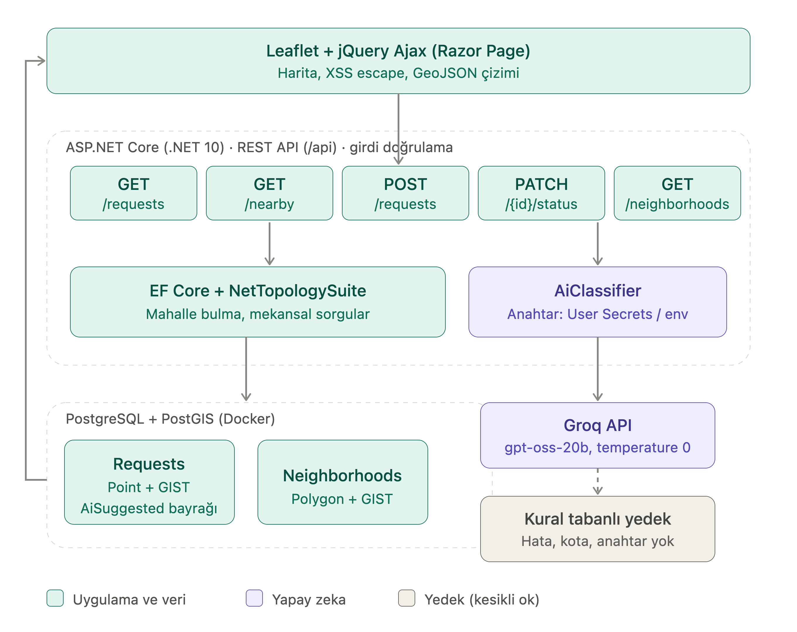
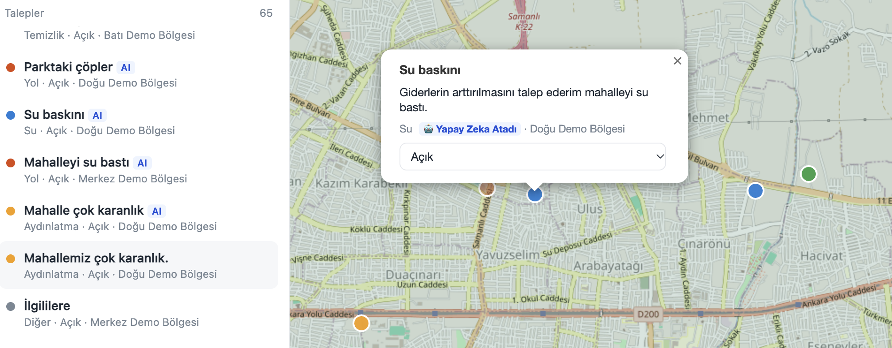

# Belediye CBS - Talep Haritası

Vatandaşların harita üzerinden altyapı/hizmet taleplerini (yol, aydınlatma, su, temizlik, park) bildirdiği,
belediye ekibinin ise bu talepleri mekansal olarak sorgulayıp yönettiği küçük bir CBS web uygulaması.

**Teknolojiler:** ASP.NET Core (.NET 10) · Razor Pages · jQuery Ajax · HTML/CSS/JS · EF Core ·
PostgreSQL + PostGIS · NetTopologySuite · Leaflet · REST API (GeoJSON) · Groq API · gpt-oss-20b (yapay zeka)

## Çalıştırma

```bash
docker compose up -d db          # PostGIS veritabanı
dotnet run                       # http://localhost:5080
```

İlk açılışta tablolar, PostGIS eklentisi ve demo veri otomatik oluşur.

Yapay zeka ile otomatik kategori için (isteğe bağlı):

```bash
export GROQ_API_KEY=...          # yoksa kural tabanlı sınıflandırıcı devreye girer
```

Geliştirme ortamında anahtar User Secrets ile de tanımlanabilir:

```bash
dotnet user-secrets set "Groq:ApiKey" "..."
```

## Proje yapısı

| Dosya | Sorumluluk |
|-------|------------|
| `Program.cs` | Sadece uygulama kurulumu: servis kayıtları, veritabanı başlatma, uç noktaların bağlanması |
| `Api.cs` | REST API uç noktaları ve istek/yanıt modelleri (DTO) |
| `Data.cs` | Entity'ler, `DbContext`, demo veri (seed) ve veritabanı başlatma |
| `Geo.cs` | Geometri fabrikası (SRID 4326) ve GeoJSON çıktı yardımcıları |
| `AiClassifier.cs` | Groq API (`openai/gpt-oss-20b`) ile kategori tahmini, yedek olarak kural tabanlı sınıflandırma |
| `Pages/Index.cshtml` | Harita arayüzü (Razor Page, Leaflet, jQuery Ajax) |

## REST API

| Metot | Yol | Açıklama |
|-------|-----|----------|
| GET | `/api/requests?category=&status=&bbox=minLon,minLat,maxLon,maxLat` | Talepler (GeoJSON FeatureCollection) |
| GET | `/api/requests/nearby?lat=&lon=&radius=` | Metre cinsinden yarıçap araması (`ST_DWithin` + `geography`) |
| POST | `/api/requests` | Yeni talep; mahalle otomatik bulunur, kategori boşsa AI belirler |
| PATCH | `/api/requests/{id}/status` | Durum güncelle |
| GET | `/api/neighborhoods` | Mahalle poligonları + açık/toplam talep sayısı |

## ⚙️ Teknik Detaylar ve Mimari



Sistem; sunum, iş mantığı, mekânsal veri ve yapay zekâ bileşenlerinin birbirinden bağımsız ve hataya dayanıklı çalıştığı 4 temel katmandan oluşur:

### 1. Sunum & Etkileşim Katmanı (Leaflet + jQuery Ajax)
* **Kullanıcı Deneyimi:** Razor Page üzerinde çalışan arayüz, vatandaşın haritadan nokta seçmesini ve serbest metinle talep iletmesini sağlar.
* **Asenkron Mekânsal Çizim:** Arka uçtan dönen GeoJSON (`FeatureCollection`) katmanları tam sayfa yenilemesi olmadan Leaflet katmanlarına dinamik olarak bind edilir[cite: 1].
* **Arayüz Güvenliği:** Olası XSS (Cross-Site Scripting) saldırılarını önlemek için kullanıcı girdileri harita balonlarında (popup) gösterilmeden önce HTML-escape işlemine tabi tutulur[cite: 1].

### 2. Uygulama & Servis Katmanı (ASP.NET Core .NET 10 & EF Core)
* **REST API:** Minimal API mimarisiyle yapılandırılmış uç noktalar (`/requests`, `/nearby`, `/neighborhoods`) üzerinden girdi doğrulama ve DTO dönüşümleri yürütülür[cite: 1].
* **Mekânsal ORM Çevrimi (NetTopologySuite):** EF Core ile PostgreSQL arasındaki mekânsal tercümandır[cite: 1]. C# geometrik tiplerini (`Point`, `Polygon`) PostGIS formatına dönüştürür[cite: 1].
* **Mekânsal Filtreleme:** Harita sınırlarına göre Bounding Box (`Within`) sorgulamaları ve point-in-polygon (`Boundary.Contains`) mantığı bu katmanda çalışır[cite: 1].
* **Veri Güvenliği:** SQL Injection riskine karşı veri erişiminde parametreli sorgular (`FromSqlInterpolated`) kullanılır.

### 3. CBS Veri Katmanı (PostgreSQL + PostGIS - Docker)
* **Mekânsal Veri Tipleri:** Talepler `geometry(Point,4326)`, mahalle sınırları ise `geometry(Polygon,4326)` tiplerinde saklanır[cite: 1].
* **GIST İndeksleri:** Mekânsal aramaların milisaniyeler seviyesinde tamamlanabilmesi için ilgili geometrik kolonlarda GIST indeksleme aktif olarak kullanılır[cite: 1].
* **Hassas Mesafe Hesabı:** SRID 4326 düzleminde mesafeler derece cinsinden olduğu için, metre bazlı kesin sonuçlar elde etmek amacıyla `ST_DWithin` sorgularında veri `geography` tipine dönüştürülür (cast edilir).

### 4. Yapay Zekâ & Hata Toleransı Hattı (Groq API & Fallback)
* **Yüksek Hızlı LLM Çıkarımı:** Serbest metinler **Groq LPU** altyapısındaki `openai/gpt-oss-20b` modeline (`temperature=0`, JSON Object) iletilerek ~300 ms gibi sub-second sürelerde analiz edilir ve otomatik kategoriye atanır[cite: 1].
* **Zarif Gerileme (Graceful Degradation):** API anahtarının eksik olduğu, kota aşımı yaşandığı veya harici servise erişilemediği anlarda sistem hata fırlatmaz; kural tabanlı (rule-based) yedek algoritma devreye girerek akışın kesilmesini önler[cite: 1].
* **Denetlenebilirlik (Auditability):** Model tarafından otomatik sınıflandırılan talepler veritabanında `AiSuggested = true` bayrağı ile işaretlenir[cite: 1].
## 📸 Ekran Görüntüleri

**1. Genel Harita Görünümü**  
Mahalle sınırları ve taleplerin genel dağılımı.  


**2. Yakın Çekim Harita İncelemesi**  
Belirli bir bölgedeki taleplerin metre bazlı yakınlık ve yoğunluk analizi.  


**3. Yapay Zeka Destekli Talep Ekranı**  
Vatandaşın konum seçerek serbest metinle talep oluşturduğu arayüz.  


**4. Talep Detay Görünümü**  
Yapay zeka (Groq / gpt-oss-20b) tarafından kategorize edilmiş talebin detayları ve durum yönetimi.  


## 🚀 Gelecek Geliştirmeler (Roadmap)

- `EnsureCreated` yapısından tam kapsamlı EF Core Migration yönetimine geçilmesi.
- Uygulamadaki demo sınırların gerçek idari sınır verileriyle (GeoJSON/Shapefile) değiştirilmesi.
- Talep bildirimlerine fotoğraf yükleme (attachment) desteğinin eklenmesi.
- Kimlik doğrulama (Authentication) altyapısı kurularak vatandaş ve personel (yönetici) yetki sınırlarının belirlenmesi.
- Yüksek hacimli mekansal verilerin performanslı renderlanabilmesi için Vector Tile (MVT) altyapısının kurulması ve GeoServer (WMS/WFS) entegrasyonu.
- xUnit ile API ve mekansal sorgu testlerinin (Unit & Integration Tests) yazılması.
- Uygulamanın .NET servisinin de tamamen Docker container ortamına taşınması.