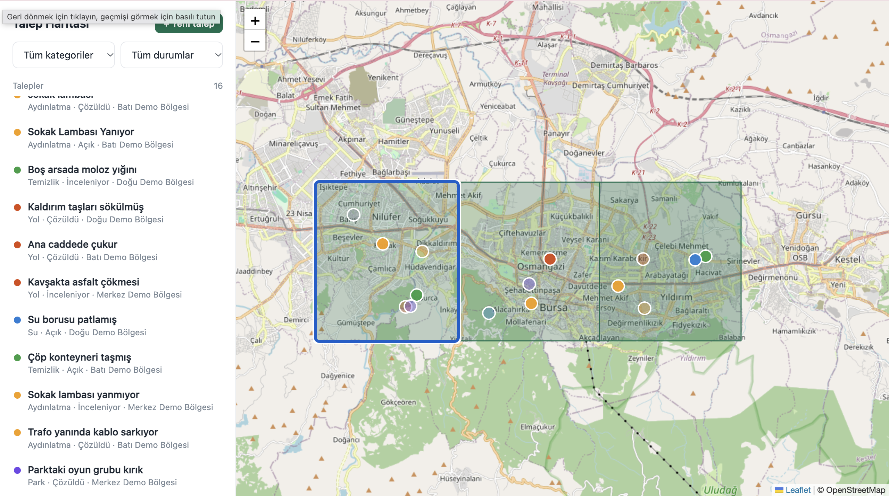
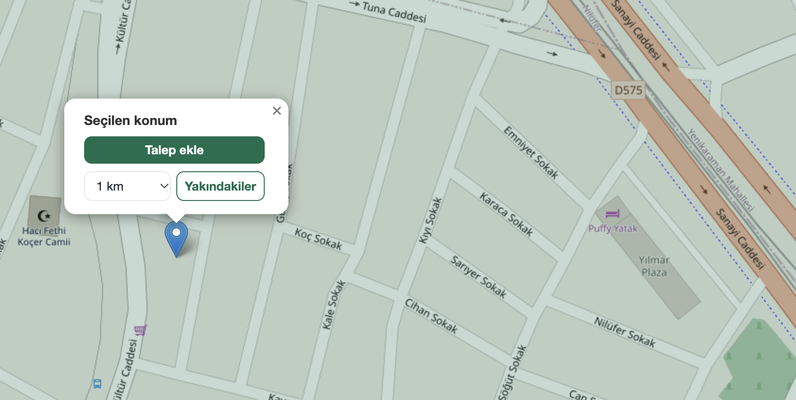
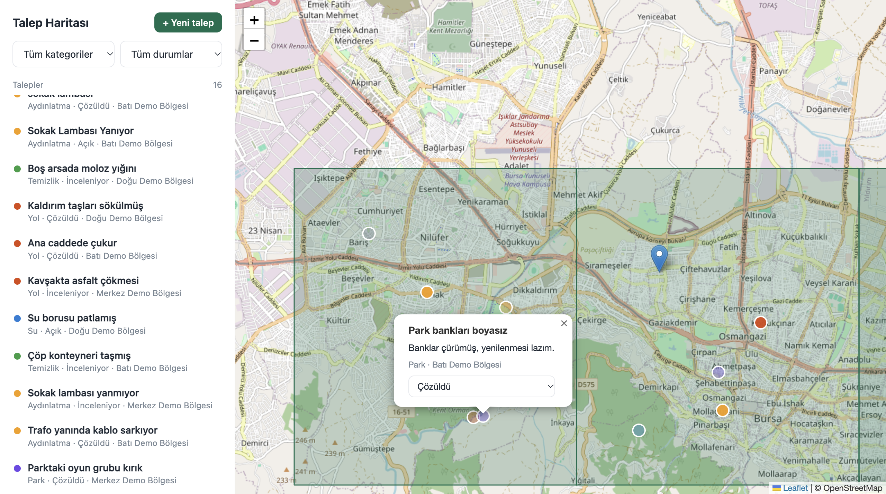

# Belediye CBS - Talep Haritası

Vatandaşların harita üzerinden altyapı/hizmet taleplerini (yol, aydınlatma, su, temizlik, park) bildirdiği,
belediye ekibinin ise bu talepleri mekansal olarak sorgulayıp yönettiği küçük bir CBS web uygulaması.

**Teknolojiler:** ASP.NET Core (.NET 10) · Razor Pages · jQuery Ajax · HTML/CSS/JS · EF Core ·
PostgreSQL + PostGIS · NetTopologySuite · Leaflet · REST API (GeoJSON) · Groq API · gpt-oss-20b (yapay zeka)

## Çalıştırma

```bash
docker compose up -d db          # PostGIS veritabanı
dotnet run                       # http://localhost:5080
```

İlk açılışta tablolar, PostGIS eklentisi ve demo veri otomatik oluşur.

Yapay zeka ile otomatik kategori için (isteğe bağlı):

```bash
export GROQ_API_KEY=...          # yoksa kural tabanlı sınıflandırıcı devreye girer
```

Geliştirme ortamında anahtar User Secrets ile de tanımlanabilir:

```bash
dotnet user-secrets set "Groq:ApiKey" "..."
```

## Proje yapısı

| Dosya | Sorumluluk |
|-------|------------|
| `Program.cs` | Sadece uygulama kurulumu: servis kayıtları, veritabanı başlatma, uç noktaların bağlanması |
| `Api.cs` | REST API uç noktaları ve istek/yanıt modelleri (DTO) |
| `Data.cs` | Entity'ler, `DbContext`, demo veri (seed) ve veritabanı başlatma |
| `Geo.cs` | Geometri fabrikası (SRID 4326) ve GeoJSON çıktı yardımcıları |
| `AiClassifier.cs` | Groq API (`openai/gpt-oss-20b`) ile kategori tahmini, yedek olarak kural tabanlı sınıflandırma |
| `Pages/Index.cshtml` | Harita arayüzü (Razor Page, Leaflet, jQuery Ajax) |

## REST API

| Metot | Yol | Açıklama |
|-------|-----|----------|
| GET | `/api/requests?category=&status=&bbox=minLon,minLat,maxLon,maxLat` | Talepler (GeoJSON FeatureCollection) |
| GET | `/api/requests/nearby?lat=&lon=&radius=` | Metre cinsinden yarıçap araması (`ST_DWithin` + `geography`) |
| POST | `/api/requests` | Yeni talep; mahalle otomatik bulunur, kategori boşsa AI belirler |
| PATCH | `/api/requests/{id}/status` | Durum güncelle |
| GET | `/api/neighborhoods` | Mahalle poligonları + açık/toplam talep sayısı |

## ⚙️ Teknik Detaylar ve Mimari

- **Mekansal Veri Modeli:** Coğrafi veriler `geometry(Point,4326)` ve `geometry(Polygon,4326)` tiplerinde saklanmış, performanslı mekansal aramalar için GIST indeksleri tanımlanmıştır. Veritabanı ile ORM arasındaki mekansal iletişim NetTopologySuite (EF Core) üzerinden sağlanmıştır.
- **Mekansal Sorgular:** Sistemde point-in-polygon (`Boundary.Contains`) ile noktanın bulunduğu poligon tespiti, Bounding Box (`Within`) ile harita görünümüne göre veri filtreleme ve mahalle bazlı mekansal toplulaştırma (aggregation) işlemleri aktif olarak kullanılmaktadır.
- **Hassas Mesafe Ölçümü:** `geometry` tipinde (SRID 4326) mesafeler derece cinsinden hesaplandığı için, metre bazlı kesin sonuçlar elde etmek amacıyla `ST_DWithin` sorgularında veri `geography` tipine cast edilerek kullanılmıştır.
- **REST API ve GeoJSON:** Uç noktalar endüstri standardı GeoJSON formatında (FeatureCollection) yanıt verir. Bu sayede Leaflet arayüzünün yanı sıra QGIS veya kurum içi farklı CBS yazılımlarıyla doğrudan entegre çalışabilir.
- **Yapay Zeka ve Hata Toleransı:** Serbest metin formatındaki vatandaş talepleri Groq API üzerinden `openai/gpt-oss-20b` modeli ile analiz edilip ilgili kategoriye atanır (`temperature=0` ile deterministik çıktı). API anahtarının eksik olduğu veya servise ulaşılamayan durumlarda sistem hata fırlatmaz; kural tabanlı (rule-based) yedek bir sınıflandırıcı devreye girer (graceful degradation). AI tahminleri veritabanında `AiSuggested` bayrağı ile işaretlenir.
- **Güvenlik:** Olası XSS açıklarına karşı arayüz katmanında kullanıcı girdileri HTML-escape işleminden geçirilir. Girdi doğrulamaları API seviyesinde ele alınmış olup, veri erişim katmanında SQL Injection riskini önlemek için parametreli sorgular (`FromSqlInterpolated`) kullanılmıştır.

## 📸 Ekran Görüntüleri

**1. Genel Harita Görünümü**  
Mahalle sınırları ve taleplerin genel dağılımı.  


**2. Yakın Çekim Harita İncelemesi**  
Belirli bir bölgedeki taleplerin metre bazlı yakınlık ve yoğunluk analizi.  


**3. Yapay Zeka Destekli Talep Ekranı**  
Vatandaşın konum seçerek serbest metinle talep oluşturduğu arayüz.  


**4. Talep Detay Görünümü**  
Yapay zeka (Groq / gpt-oss-20b) tarafından kategorize edilmiş talebin detayları ve durum yönetimi.  


## 🚀 Gelecek Geliştirmeler (Roadmap)

- `EnsureCreated` yapısından tam kapsamlı EF Core Migration yönetimine geçilmesi.
- Uygulamadaki demo sınırların gerçek idari sınır verileriyle (GeoJSON/Shapefile) değiştirilmesi.
- Talep bildirimlerine fotoğraf yükleme (attachment) desteğinin eklenmesi.
- Kimlik doğrulama (Authentication) altyapısı kurularak vatandaş ve personel (yönetici) yetki sınırlarının belirlenmesi.
- Yüksek hacimli mekansal verilerin performanslı renderlanabilmesi için Vector Tile (MVT) altyapısının kurulması ve GeoServer (WMS/WFS) entegrasyonu.
- xUnit ile API ve mekansal sorgu testlerinin (Unit & Integration Tests) yazılması.
- Uygulamanın .NET servisinin de tamamen Docker container ortamına taşınması.